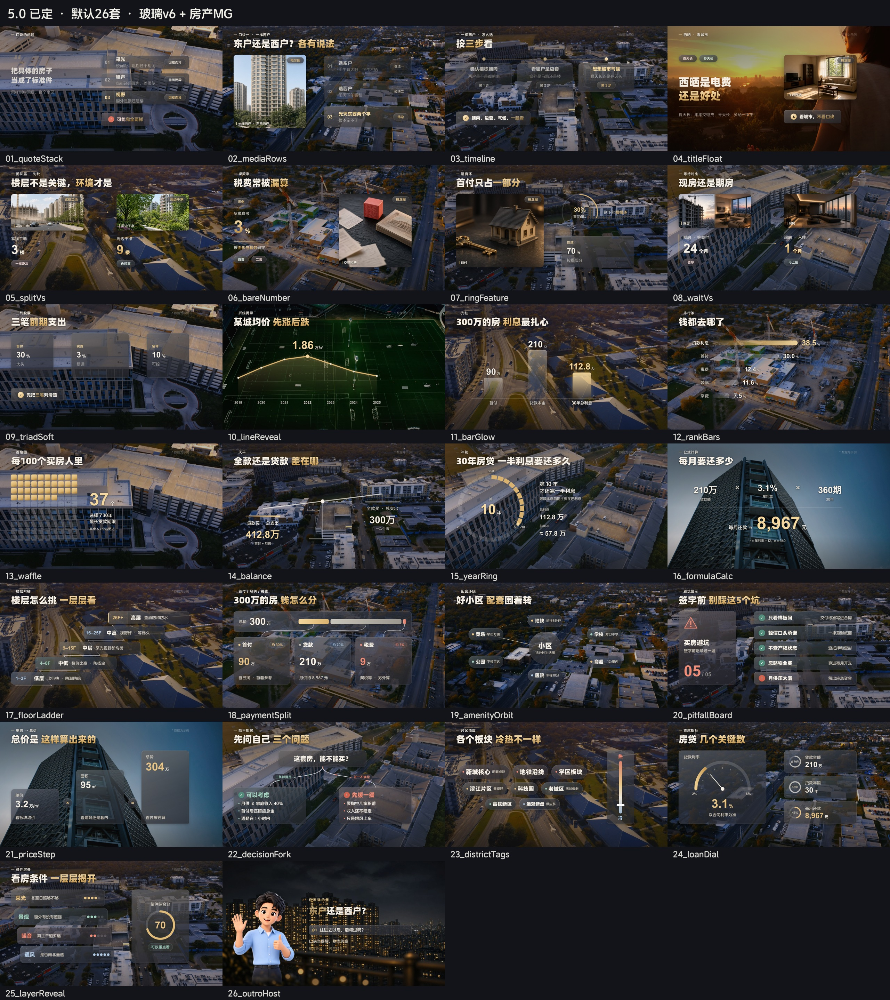
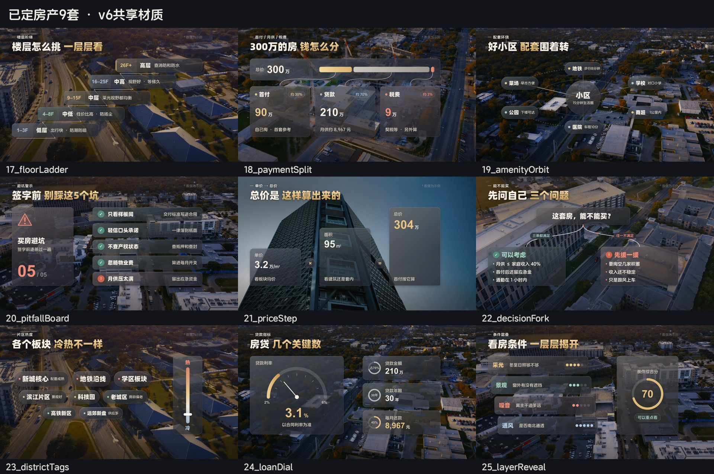
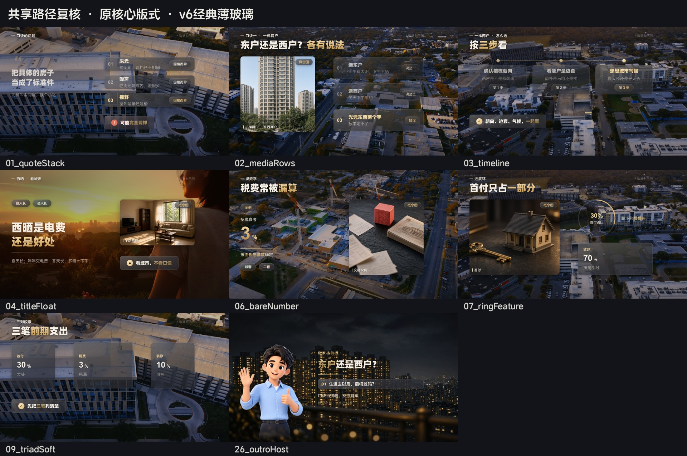

# 5.0 新定版（玻璃v6 + 房产MG）

已定：2026-11-06（Asia/Shanghai），视觉升级暖雾磨砂 v6.1：2026-11-12。2026-11-13 卡片再收一版：圆角和异形更圆，卡内字分序号 / 标题 / 说明，中景侧转并留接触阴影，户型拆解保持近正视。片头保持原样。正片默认仍是 26 种（原核心 10 + 数据 7 + 房产 9），另外 17 款新 MG 进选卡池，不替换原版式。卡片是暖雾磨砂（模糊只在卡内），字幕定版不改。

- 流程：SKILL.md、正片/SKILL.md。
- 规范与默认轮换：正片/references/风格设计规范.md、版式目录.md。
- 文案匹配和排版硬约束：正片/references/文案匹配机制.md、排版底层约束.md、设计说明.md；机器规则在正片/template/match_rules.json。检查：`npm run check:constraints`。背景亮度：`npm run luma`。
- 新卡中帧定格：`previews/v6.2/`（含 X01、X02、X04、X05、X08、X10 和片尾）。上一版留在 `previews/v6.1/`。
- 认可房产预览：outputs/mg-gallery-re10/；新版共享复核：outputs/freeze-v6/。
- 本地交接与关键文件：定版交接_5.0_玻璃v6.md；校验与变更清单：定版记录/。
- 模板目录：正片/template/。不推送GitHub、不Copy Mac、不自动外发；独立4.5及既有成片保持不变。

## 5.0 新定版预览（玻璃 v6 + 房产 MG，2026-11-06）

早期成片截图见 `previews/5.0成片/`。
