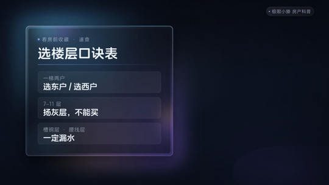
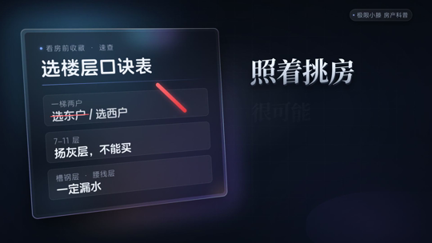
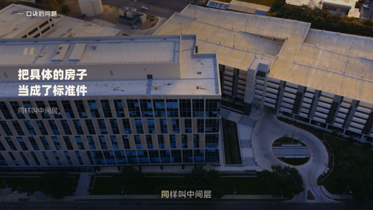
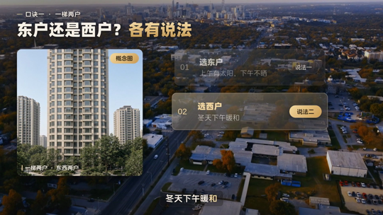
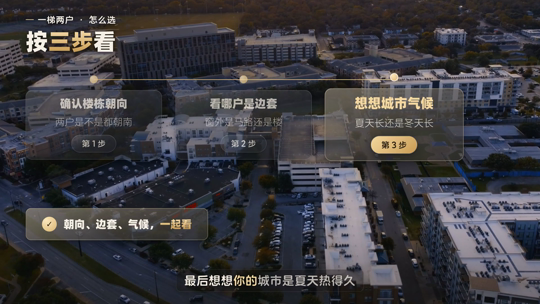
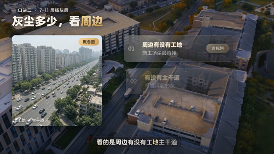
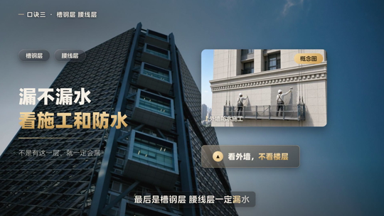
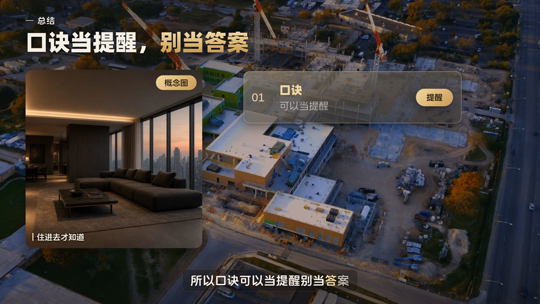

# 小滕视频风格模板5.0版

一个模板里同时装着**片头**（小滕片头风格）和**正片**（小滕分镜风格 4.5 升级版）：每期先做片头、再做正片，最后用 `scripts/concat.mjs` 拼成一条成片。详细用法见 `SKILL.md`。

## 5.0 主要升级
- 背景整体提亮，不再偏暗；片头为冷色「大厂深空玻璃风」，不用纯黑
- 背景不模糊，同一期内素材不重复
- 文字卡片元素大小协调，可读性更好
- 新增 7 种数据图表样式（折线、排名条、方块格、天平、进度环、月供计算等）
- 配合 [时间码字幕生成工具2.0](https://github.com/pensongchs/shijianma-zimu-shengcheng-gongju-2.0) 做字幕和画面对齐

## 预览图（取自 5.0 成片《选楼层口诀》）
| | |
|---|---|
|  |  |
|  |  |
|  |  |
|  |  |

制作过程中的样式小样（含早期片头方案）见 `previews/` 目录。
